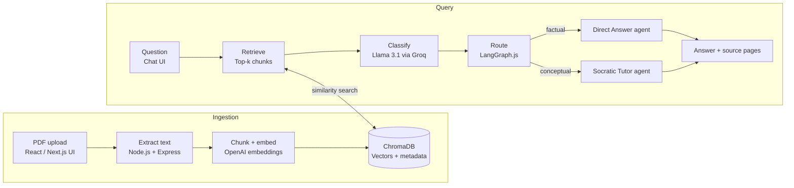

# PRD: AI Teaching Assistant – An Agentic RAG System for Socratic Tutoring

**Programme:** B.Tech CSE, Semester 7 (Project Review 3)
**Guide:** Ms. Ria Pyne
**Team:** Aminul Islam, Ayan Mahapatra, Md Yusuf, Soniya Samanta, Soubhik Das
**Date:** 2026-11-06

---

## 1. Overview

The AI Teaching Assistant is a web-based tutor that answers students' questions from their own course PDFs and switches teaching style by question type: direct answers for factual questions, Socratic guidance for conceptual ones.

### 1.1 Vision

A student can ask a question at any hour and get an answer that is verifiably from the course material, with the source file and page shown. For concepts, the system guides the student to reason their way to the answer instead of handing it over.

### 1.2 Problem statement

| Problem | Impact on students |
| --- | --- |
| Instructor access is limited outside class hours | Help is late and inconsistent |
| Course PDFs and notes are hard to search by meaning | Ctrl+F misses context and synonyms |
| General LLMs hallucinate or drift from the course | Answers may be wrong or irrelevant to the syllabus |
| Factual and conceptual questions need different teaching styles | One-size-fits-all answers either over-explain facts or give away concepts |

### 1.3 Existing approaches and the gap

Classroom teaching, online learning platforms, intelligent tutoring systems (ITS) and AI chatbots each cover part of the need. Their limits: little one-to-one time, no support outside class, restriction to fixed subjects or content, and unreliable AI answers. The gap is an interactive assistant that is accessible, grounded in the student's own material, and pedagogically aware.

### 1.4 Primary innovation

Course-grounded RAG (retrieval-augmented generation) + agentic decision-making that routes each question + Socratic tutoring that preserves accuracy while encouraging student reasoning.

---

## 2. Goals, non-goals and success metrics

### 2.1 Goals

1. Build a course-grounded RAG pipeline with Node.js ingestion of PDFs.
2. Classify each question as factual or conceptual and route it to the right agent.
3. Deliver direct grounded answers or Socratic guidance, always with source and page metadata.
4. Provide a React/Next.js web chat interface for upload, chat and source viewing.
5. Refuse or flag answers when the course material does not support them.

### 2.2 Non-goals (current version)

- Replacing instructors or grading student work.
- Answering from general web knowledge when the course material has nothing relevant.
- Scanned or image-only PDFs, handwriting and diagrams, unless OCR is added later.
- Multi-institution administration, billing or LMS integration.

### 2.3 Success metrics

Targets are proposed starting points. The Review 3 deck leaves measured values blank, so replace them with real results.

| Metric | How measured | Proposed target |
| --- | --- | --- |
| Retrieval relevance | Relevant chunk in top-k for N labelled test questions | 85% or higher |
| Classifier accuracy | Agreement with N hand-labelled factual/conceptual questions | 90% or higher |
| Answer grounding | Share of answers fully supported by the retrieved source | 90% or higher |
| Unsupported-question handling | Out-of-scope questions that get a "not found in course material" reply | 95% or higher |
| Response time | Average end to end, question sent to answer shown | Under 6 seconds |
| Student feedback | Peers or students try it, short survey | Qualitative summary, majority positive |

---

## 3. Users and user stories

### 3.1 Personas

| Persona | Needs | Pain today |
| --- | --- | --- |
| Student (primary) | Quick, correct, syllabus-aligned help; understanding, not just answers | Cannot reach the instructor at night; generic chatbots go off-syllabus |
| Instructor / course admin | Upload course PDFs once; trust that answers match the material | Repeats the same explanations; worries about AI misinformation |

### 3.2 User stories

| ID | As a... | I want to... | So that... | Priority |
| --- | --- | --- | --- | --- |
| U1 | Student | Upload my course PDF | The assistant answers from my material | Must |
| U2 | Student | Ask a factual question and get a short direct answer | I save time on definitions and lookups | Must |
| U3 | Student | Ask a conceptual question and be guided with questions | I learn to reason it out myself | Must |
| U4 | Student | See the source file and page for every answer | I can verify it in the original PDF | Must |
| U5 | Student | Be told when the material does not cover my question | I am not misled by a made-up answer | Must |
| U6 | Student | Ask follow-up questions in the same chat | I do not repeat context each time | Should |
| U7 | Student | Open the cited page in a source viewer | I read the surrounding context | Should |
| U8 | Instructor | Upload and manage several course documents | The assistant covers the full course | Should |
| U9 | Student | Ask for a direct answer after trying the Socratic steps | I am not stuck when I need the answer | Could |

---

## 4. Technology stack

JavaScript/TypeScript end to end.

| Layer | Technology | Role |
| --- | --- | --- |
| Language | JavaScript / TypeScript | Shared across frontend and backend |
| Frontend | React / Next.js | Upload UI, chat interface, source viewer |
| Backend | Node.js + Express.js | PDF processing, ingestion, APIs |
| Orchestration | LangGraph.js | Agent routing, dialog state and memory, fallbacks |
| Vector database | ChromaDB | Vector storage and similarity search |
| Embeddings | OpenAI embeddings | Chunk and query vectors |
| LLM | Llama 3.1 via Groq API (or a compatible LLM) | Question classification and answer generation |
| PDF parsing | A JS PDF library (to be named) | Page-level text extraction with page metadata |
| Testing tool | To be named | Automated tests (the Review 3 deck leaves this open) |

**Core pipeline:** React/Next.js → Express.js → LangGraph.js → ChromaDB → Groq/OpenAI.

**Key references:** Lewis et al. (RAG), LangChain and LangGraph docs, OpenAI embeddings guide, Chroma docs, Groq API docs, Next.js and Express.js docs, Dubey et al. (Llama 3 Herd of Models).

---

## 5. Scope and functional requirements

Six modules, matching the module-wise status slide in the Review 3 deck.

### 5.1 Module 1: PDF ingestion

- **FR-1.1** The web UI lets a user upload one or more PDF files.
- **FR-1.2** The Node.js backend validates file type and size and rejects invalid files with a clear message.
- **FR-1.3** Text is extracted page by page with a JS PDF library, keeping source file name and page number for each page.
- **FR-1.4** Empty or image-only pages are detected and reported instead of silently ingested.
- **FR-1.5** Re-uploading the same file does not create duplicate vectors.

### 5.2 Module 2: Chunking and embeddings

- **FR-2.1** Page text is split into overlapping chunks. Chunk size and overlap are configurable.
- **FR-2.2** Each chunk keeps metadata: source file, page number, chunk index.
- **FR-2.3** Each chunk is converted to a vector with OpenAI embeddings, in batches, with retry on rate limits.

### 5.3 Module 3: Vector store and retrieval

- **FR-3.1** Vectors and metadata are stored in ChromaDB.
- **FR-3.2** The question is embedded with the same model, and a similarity search returns the top-k chunks.
- **FR-3.3** A relevance threshold drops weak matches. If nothing passes, the system replies that the course material does not cover the question.
- **FR-3.4** Retrieved chunks carry source and page metadata through to the answer.

### 5.4 Module 4: Question classifier

- **FR-4.1** Llama 3.1 via Groq labels each question as `factual` or `conceptual`.
- **FR-4.2** The label is returned as structured output. On a parse failure or low confidence, the system falls back to a default route (section 6).
- **FR-4.3** The classification is logged for evaluation.

### 5.5 Module 5: Agent routing (Direct Answer and Socratic)

- **FR-5.1** LangGraph.js routes factual questions to the Direct Answer agent and conceptual questions to the Socratic Tutor agent.
- **FR-5.2** Both agents answer only from the retrieved chunks.
- **FR-5.3** Graph state holds the conversation, retrieved chunks and route so follow-ups work.
- **FR-5.4** Every response lists the sources used, as file name and page.

### 5.6 Module 6: Chat UI and source viewer

- **FR-6.1** A React/Next.js chat interface shows the conversation with a visible indicator of which mode answered (direct or Socratic).
- **FR-6.2** Each answer shows source chips (file and page). Clicking a chip opens the source viewer at that page.
- **FR-6.3** Upload progress and ingestion status are visible.
- **FR-6.4** Loading, empty and error states are handled for upload and chat.

### 5.7 Release scope

| Release | Includes | Basis |
| --- | --- | --- |
| MVP (Review 3) | FR-1.x to FR-6.x, single course collection, text-only PDFs | Core of both decks |
| Next (Review 4 / final) | To be confirmed: conversation memory, source-page viewer polish, hybrid retrieval or re-ranking, quiz mode | Review 3 deck lists these only as examples |
| Later | OCR for scanned PDFs, multi-course support, instructor dashboard, analytics | Future scope |

---

## 6. Agent behavior

Every question follows one path: retrieve, check relevance, classify, route, answer with sources.

### 6.1 Routing rules

| Step | Condition | Result |
| --- | --- | --- |
| Retrieve | Top-k chunks fetched for the question | Chunks with similarity scores |
| Relevance check | No chunk passes the threshold | Reply: not covered by the course material; suggest rephrasing or uploading the right file. No agent is called. |
| Classify | Label = `factual` | Direct Answer agent |
| Classify | Label = `conceptual` | Socratic Tutor agent |
| Classify | Parse error or low confidence | Default route (proposed: Direct Answer) |
| Respond | Agent output ready | Answer text plus source list (file, page) |

### 6.2 Direct Answer agent

Used for definitions, formulas, dates, "what is" and "list" questions.

- Answers in a few sentences using only the retrieved chunks.
- States the source file and page for each claim.
- If the chunks only partly answer the question, says what is missing instead of filling the gap from general knowledge.

### 6.3 Socratic Tutor agent

Used for "why", "how does", "explain" and "compare" questions.

- Opens with one short guiding question or hint based on the retrieved material, not the full answer.
- Builds on the student's reply across turns using conversation state.
- Points to the relevant source page so the student can read it.
- Gives the full explanation when the student asks directly or is stuck after repeated attempts (proposed: after 3 turns, to be confirmed).

### 6.4 Prompt contracts

| Prompt | Must instruct the model to | Output |
| --- | --- | --- |
| Classifier | Choose exactly one label, with a one-line reason and a confidence value | JSON: `label`, `confidence`, `reason` |
| Direct Answer | Use only supplied context; cite file and page; say "not found" if absent | Text plus citations |
| Socratic Tutor | Ask guiding questions; never reveal the full answer on the first turn; use only supplied context | Text plus citations |

### 6.5 Failure handling

| Failure | Behavior |
| --- | --- |
| Groq or OpenAI API error or timeout | Retry once, then show a friendly error and keep the chat state |
| Rate limit | Back off and queue; show a "working on it" state |
| ChromaDB unavailable | Show an error and log it; do not answer without retrieval |
| Model output ignores the context | Check output against retrieved chunks, regenerate once, otherwise return the "not found" reply |

---

## 7. System architecture and data

Two pipelines share one ChromaDB store: ingestion writes vectors and metadata, and the query pipeline reads them.

### 7.1 Data flow

**Ingestion**

1. The student uploads a PDF in the React/Next.js UI.
2. Node.js and Express extract text page by page and keep source and page metadata.
3. Text is split into overlapping chunks and embedded with OpenAI embeddings.
4. Vectors and metadata are stored in ChromaDB.

**Query**

1. The student sends a question from the chat UI.
2. The question is embedded and ChromaDB returns the top-k chunks above the relevance threshold.
3. Llama 3.1 (via Groq) labels the question factual or conceptual.
4. LangGraph.js routes to the Direct Answer or Socratic Tutor agent.
5. The answer returns with source file and page references.

### 7.2 Data model

| Record | Fields |
| --- | --- |
| Document | `documentId`, file name, upload time, page count, status (uploaded, indexing, ready, failed) |
| Chunk | `chunkId`, `documentId`, source file name, page number, chunk index, text, embedding vector |
| Conversation | `conversationId`, list of messages, last route, last retrieved chunk IDs |
| Message | role (student or assistant), text, route label, source list (file, page), timestamp |
| Query log | question, route label, confidence, retrieved chunk IDs and scores, latency |

### 7.3 API design (proposed)

| Endpoint | Purpose |
| --- | --- |
| `POST /api/documents` | Upload a PDF and start ingestion |
| `GET /api/documents` | List uploaded documents and their status |
| `DELETE /api/documents/:id` | Remove a document and its vectors |
| `GET /api/documents/:id/pages/:n` | Return page text or image for the source viewer |
| `POST /api/chat` | Send a question with a `conversationId`; returns answer, route, sources |

### 7.4 Configuration values

Chunk size, chunk overlap, top-k, relevance threshold, embedding model name, Groq model name, request timeout and the Socratic turn limit are set in configuration, so the team can tune them against the evaluation set without code changes.

---

## 8. Non-functional requirements and UX

| Area | Requirement |
| --- | --- |
| Accuracy | Answers must be supported by retrieved chunks; unsupported questions get a "not found" reply |
| Traceability | Every answer shows source file and page |
| Performance | Average end-to-end response under 6 seconds (proposed); ingestion shows progress for large PDFs |
| Reliability | API failures are retried once and surface a clear error; chat state is not lost |
| Security | API keys only in server environment variables; uploads validated by type and size; no keys in the browser |
| Privacy | Uploaded course files and chat logs are used only for this app; define a deletion path before real student use |
| Maintainability | Chunk size, overlap, top-k, threshold and model names are config values, not hard-coded |
| Cost | Embed each file once; batch embedding calls; use Groq for generation |
| Usability | Works on current desktop browsers and is usable at phone width |
| Observability | Log route label, retrieved chunk IDs, scores and latency per question |

**UX requirements**

- One screen with an upload panel, a chat pane and a source viewer.
- A mode badge on each reply (Direct or Socratic).
- Source chips under every answer; clicking opens the page.
- Clear states for empty chat, uploading, indexing, thinking and error.
- A "just give me the answer" control in Socratic mode (story U9).

---

## 9. Evaluation, risks, timeline and open questions

### 9.1 Evaluation plan

| Test | Method | Pass condition |
| --- | --- | --- |
| Retrieval relevance | N questions with known source page; check the page is in top-k | Meets target in 2.3 |
| Classifier accuracy | Hand-label N factual and conceptual questions; compare with the model | Meets target in 2.3 |
| Answer grounding | Review sampled answers against their cited chunks | Every claim traceable to a cited page |
| Out-of-scope handling | Ask questions the PDFs do not cover | "Not found" reply, no invented answer |
| Socratic quality | Conceptual replies open with a guiding question and do not give the full answer on turn one | Rubric agreed with the guide |
| Response time | Time N questions end to end | Meets target in 2.3 |
| User feedback | Peers use it and fill a short survey | Summary in the final deck |

### 9.2 Risks and mitigations

| Risk | Likelihood | Mitigation |
| --- | --- | --- |
| Model answers beyond the context (hallucination) | Medium | Strict prompts, relevance threshold, output check, "not found" fallback |
| Misclassified question gets the wrong teaching style | Medium | Structured output with confidence, default route, manual "give me the answer" control |
| Poor chunking splits an idea across chunks | Medium | Overlapping chunks, tune size and overlap against the test set |
| Scanned or image-only PDFs yield no text | Medium | Detect and warn; OCR as future scope |
| API rate limits or outages (OpenAI, Groq) | Medium | Batching, retry with back-off, clear error states |
| API cost grows with usage | Low | Embed once, cache, config limits on top-k and context length |
| Course files contain copyrighted or private material | Low | Use only files the team may use; define deletion before wider use |

### 9.3 Timeline

The original proposal planned five weeks. Review 4 dates are not in the deck.

| Phase | Focus |
| --- | --- |
| Week 1 | Problem analysis and literature review |
| Week 2 | PDF processing, chunking and embeddings |
| Week 3 | Semantic retrieval and question routing |
| Week 4 | Response generation and UI development |
| Week 5 | Integration, evaluation, documentation and presentation |
| Review 4 / final | Planned items with dates (to be filled), final report in the prescribed format |

### 9.4 Open questions

- What did Review 2 suggest, and what was done? Slide 3 of the Review 3 deck is still a template.
- Which innovations were added since Review 2 (conversation memory, re-ranking, quiz mode, relevance threshold)?
- Which PDF library and testing tool, and which chunk size, overlap, top-k and threshold values are in use?
- Who owns each of the six modules, and what is each module's status?
- What is the group number, and what are the Review 4 dates?
- Should the classifier's default route on low confidence be Direct Answer or Socratic?
- How many turns before the Socratic agent gives the full answer?

### 9.5 Sources

- P. Lewis et al., "Retrieval-Augmented Generation for Knowledge-Intensive NLP Tasks," NeurIPS, 2020. arXiv:2005.11401
- A. Dubey et al., "The Llama 3 Herd of Models," Meta AI, 2024. arXiv:2407.21783
- LangGraph.js: langchain-ai.github.io/langgraphjs
- Chroma: docs.trychroma.com
- OpenAI embeddings: platform.openai.com/docs/guides/embeddings
- Groq API: console.groq.com/docs
- Next.js and Express.js: nextjs.org/docs, expressjs.com
- Project Review 3 deck and the original project proposal deck (provided by the team)
