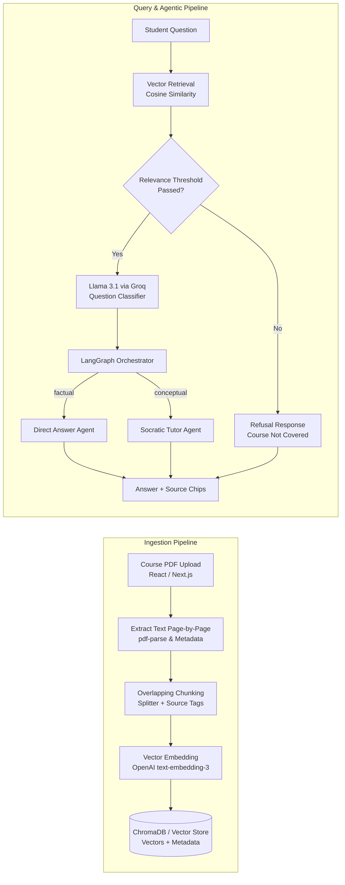

# AI Teaching Assistant – An Agentic RAG System for Socratic Tutoring

**B.Tech CSE Semester 7 Project**  
**Guide:** Ms. Ria Pyne  
**Team Members:** Aminul Islam, Ayan Mahapatra, Md Yusuf, Soniya Samanta, Soubhik Das  

---

## 🚀 Overview

The **AI Teaching Assistant** is a pedagogical agentic RAG system that answers students' academic questions grounded exclusively in their uploaded course PDFs. It dynamically switches teaching styles based on question classification:
- **Direct Answer Agent (Factual queries):** Delivers direct, concise answers with source file and page citations for definitions, formulas, dates, and lookups.
- **Socratic Tutor Agent (Conceptual queries):** Guides students with targeted questions and hints referencing relevant course pages to encourage self-directed reasoning before revealing full answers.
- **Refusal / Fallback:** Automatically refuses or flags out-of-scope questions when course notes do not support the answer (preventing hallucination).

---

## 🏛️ System Architecture



---

## 📦 Project Structure

```
.
├── backend/
│   ├── src/
│   │   ├── config.ts                    # Central configuration (chunking, threshold, models)
│   │   ├── app.ts                       # Express application setup & CORS
│   │   ├── server.ts                    # Server initialization
│   │   ├── modules/
│   │   │   ├── ingestion/               # Module 1: PDF ingestion & page extraction
│   │   │   ├── chunking/                # Module 2: Overlapping text splitter & embeddings
│   │   │   ├── vectorstore/             # Module 3: ChromaDB client & similarity retrieval
│   │   │   ├── classifier/              # Module 4: Groq Llama 3.1 question classifier
│   │   │   └── agents/                  # Module 5: LangGraph workflow, Direct & Socratic agents
│   │   └── routes/                      # API routes (/api/documents, /api/chat)
│   ├── tests/                           # Vitest automated test suite (Modules 1-5)
│   ├── .env.example
│   └── package.json
├── frontend/                            # Module 6: Next.js + React + Tailwind CSS
│   ├── src/
│   │   ├── app/                         # App router (layout, globals.css, page.tsx)
│   │   ├── components/                  # UI components (ChatPane, DocumentPanel, SourceViewer, ModeBadge)
│   │   └── lib/                         # API client & TypeScript interfaces
│   └── package.json
├── docker-compose.yml                   # ChromaDB vector database container service
└── package.json                         # Root project scripts
```

---

## ⚙️ Quickstart

### 1. Configure Environment Variables

Copy `.env.example` in `backend/`:
```bash
cp backend/.env.example backend/.env
```

Configure your API keys in `backend/.env`:
```env
OPENAI_API_KEY=sk-...
GROQ_API_KEY=gsk-...
CHROMA_URL=http://localhost:8001
RELEVANCE_THRESHOLD=0.15
```

> **Note:** The backend contains built-in local vector fallback and linguistic heuristic classifiers, allowing full offline testing even without external API keys or Docker running.

### 2. Optional: Start ChromaDB with Docker

```bash
docker compose up -d
```
*(Runs persistent ChromaDB on port 8001)*

### 3. Run Backend & Frontend

In two terminal tabs (or using root scripts):

**Backend:**
```bash
npm run dev:backend
# Server runs on http://localhost:5000
```

**Frontend:**
```bash
npm run dev:frontend
# App runs on http://localhost:3000
```

---

## 🧪 Automated Test Suite

Run the comprehensive unit and integration test suite:
```bash
npm test
```

Verifies:
- **Module 2:** Overlapping text chunking & metadata preservation.
- **Module 3:** Vector similarity search & relevance threshold filtering.
- **Module 4:** Question classification (factual vs conceptual).
- **Module 5:** LangGraph StateGraph agent routing, Socratic guidance, direct answer override, and out-of-scope refusal.

---

## 📡 API Reference

| Method | Endpoint | Description |
|---|---|---|
| `GET` | `/api/health` | Healthcheck and services status |
| `POST` | `/api/documents` | Upload and index course PDFs (`multipart/form-data`) |
| `GET` | `/api/documents` | List uploaded course documents |
| `DELETE` | `/api/documents/:id` | Delete document and vector embeddings |
| `GET` | `/api/documents/:id/pages/:n` | Fetch page text for the interactive Source Viewer |
| `POST` | `/api/chat` | Send question (`question`, `conversationId`, `forceDirectAnswer`) |
| `GET` | `/api/chat/logs` | Retrieve query latency and classification evaluation logs |

